<div align="center">

# ☀️ A lamp designed end to end by AI

**I gave the prompts. Claude did the rest through its tool connections: the PCB in KiCad, a parametric enclosure in Fusion 360, the renders, the print files and the PCB order files.**

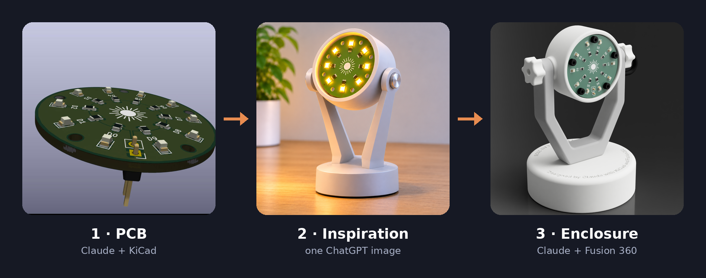


**3 chats with Claude · 1 image from ChatGPT · ~60 messages from me · ~900 tool calls by Claude**

</div>

<p align="center">
  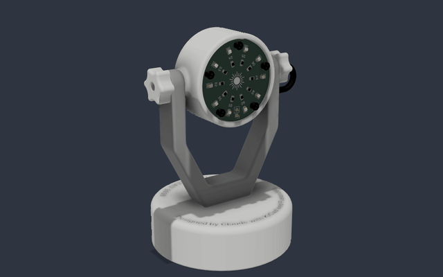
  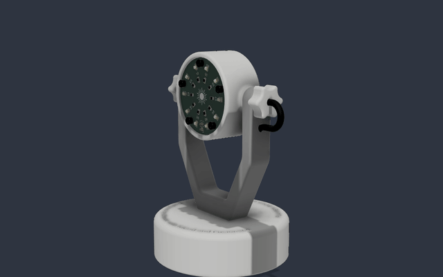
</p>

---

## What is this?

A small battery lamp: a round 36 mm PCB with ten LEDs and a sun logo, held in a tilting head on a two-armed stand, with three AAA batteries hidden in the base.

The point of the project wasn't the lamp. I wanted to see how far an AI could get with **real engineering tools** while I stayed in the chat. I didn't draw a schematic, route a trace or sketch a profile. Claude drove KiCad and Fusion 360 directly, through MCP servers (connections that let it call the apps' own functions), and I described what I wanted, answered its questions and pushed back when I disagreed.

This README tells how that went, chat by chat, including the parts where I had to step in.

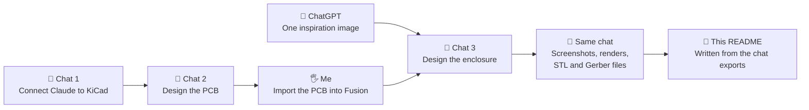

| Chat | When | My messages | Claude's tool calls | Result |
|---|---|---|---|---|
| **KiCad MCP tools setup** | Oct 17 | 22 | 41 | Claude can drive KiCad |
| **LED circuit KiCad project** | Oct 17 and Nov 11 | 31 | 485 (366 in KiCad) | 36 mm PCB, ERC and DRC fully clean |
| **Fusion360 lamp enclosure design** | Nov 12 | 7 | 390 (225 in Fusion 360) | Enclosure, renders, videos, every file to build it |

---

## Chapter 0: Teaching Claude to use KiCad

My very first message was a test:

> *"Show me what you can do in Kicad. I just created a new project and opened the schematic and PCB editors. Use the KiCad MCP tools to create a simple schematic and PCB of your choice."*

Claude's answer: it couldn't, because it had no KiCad tools. So the first chat turned into two hours of setup.

1. **Install the bridge.** I installed [Konnect](https://github.com/mixelpixx/Konnect), an open-source MCP server for KiCad, as a KiCad plugin, and turned on the KiCad API in the preferences.
2. **Register it with Claude.** It goes in the `mcpServers` section of the Claude desktop app's config file. That took several tries: my first file was in the wrong folder, and the Microsoft Store version of the app keeps its config in yet another one.
3. **Tools appeared, but only a few.** Konnect starts with a small starter set and loads the rest on demand, and the Claude app only reads the tool list once, when it connects. Claude could open a schematic viewer, but it couldn't place a single component.
4. **I pushed back.** Claude suggested switching to a little-known fork built around this problem. I wasn't convinced:

   > *"But are you sure about this ? We are talking about a 5 stars fork of a 1.2k stars project.. Why don't konnect works and why would kicad-agentic-mcp work ?"*

   Claude backed down and admitted it had been guessing. I asked it to dig through Konnect's issues and docs instead, and it found the fix in Konnect's own troubleshooting guide: one setting, `"eager_toolsets": true`.
5. **I started a fresh chat**, and Claude had all 228 KiCad tools.

> [!TIP]
> **If you want to try this:** set `"eager_toolsets": true` in Konnect's `settings.json`, **start KiCad before the Claude desktop app** (Konnect picks up KiCad's API socket when it launches), and open a new chat after you change any tool setup.

---

## Chapter 1: The PCB in KiCad

The second chat started from the prompt Claude had drafted for me at the end of the setup chat:

> *"Use the Konnect tools to build a small example in my KiCad project: a simple LED circuit (connector, resistor, LED) in the schematic, run ERC, then sync it to the PCB, add a small board outline, place and route the footprints, and run DRC."*

Six minutes and 59 tool calls later there was a schematic, a routed board, **ERC 0 errors, DRC 0 errors**. Then it got interesting.

<table>
<tr>
<td width="50%">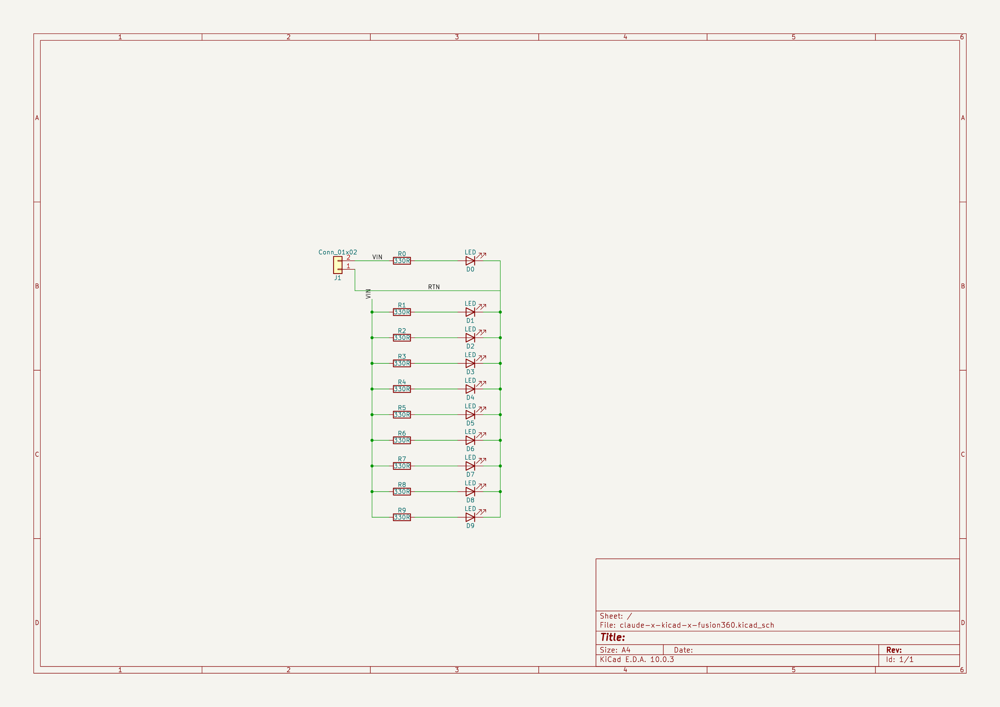</td>
<td width="50%">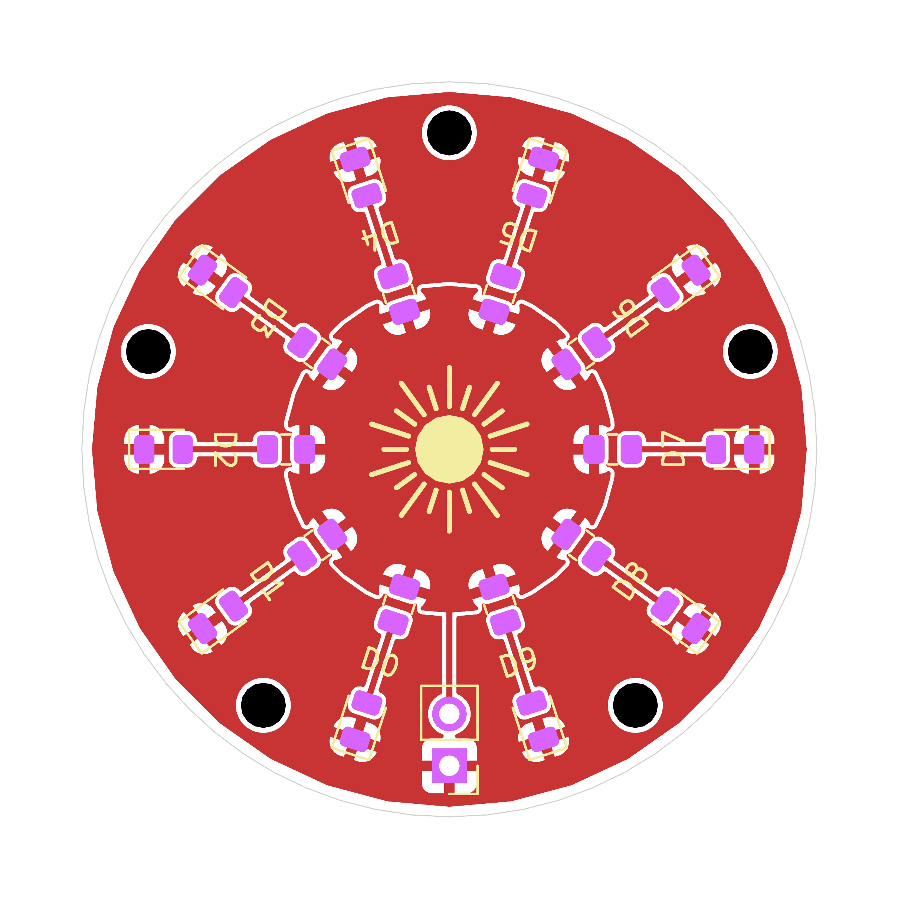</td>
</tr>
<tr>
<td align="center"><sub>Schematic: J1 feeds ten resistor and LED branches</sub></td>
<td align="center"><sub>Board: single copper layer, VIN disc in the centre, ground pour around it</sub></td>
</tr>
</table>

### How the board evolved, one prompt at a time

| I said | Claude did |
|---|---|
| *"now I want 10 LEDs arranged in a circle. Also add the 3d models if you can"* | 21 parts on a 70 mm round board, 41 routed segments, 3D models, a STEP export. KiCad's API refused non-90° rotations of these footprints, so it asked me before snapping them to 90°. |
| *"reduce the PCB size, add a ground plane, get rid of the sharp angles … align everything nicely with proper angles, including the silkscreen"* | Proposed a two-layer board with a ground plane on the back. |
| *"Am I understanding that you're gonna use 2 layers? I don't think that's necessary."* | Agreed and redesigned it on **one layer**: a VIN pour in the middle, a ground pour around it and ten straight radial traces. That's ten vias, ten stubs and a copper layer fewer. To get true radial angles it wrote the rotations straight into the board file while KiCad was closed. |
| *"I want a smaller board … the names of the LEDs to face the outside … And I want a little sun logo in the middle … with twice the rays, the one in the same line as the components being a little smaller"* | A 36 mm board, and a sun footprint generated from scratch: 20 rays, short ones on the component axes and long ones between them. |
| *"something to attach the PCB to a future 3D print, and … the connector to be mounted in the back"* | Five M2 mounting holes in the gaps between LEDs, the LED ring renumbered clockwise from the connector, and the connector's 3D model moved under the board. |
| *"I don't want any error nor warning"* | Sorted the 37 warnings into three kinds of metadata mismatch and told me which KiCad menu clears each one. |
| *"rename the LEDs D0 to D9"* + *"the resistors should also be from 0 to 9"* | Renamed all 20 parts, rerouted and relabelled. Final result: **DRC 0 errors, 0 warnings, 0 unconnected.** |

<p align="center">
  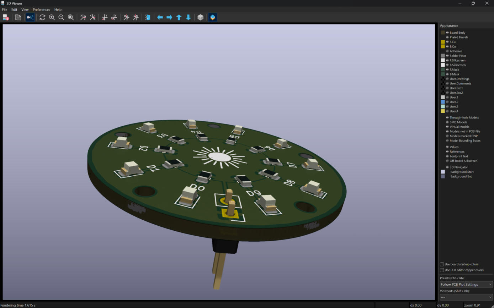
  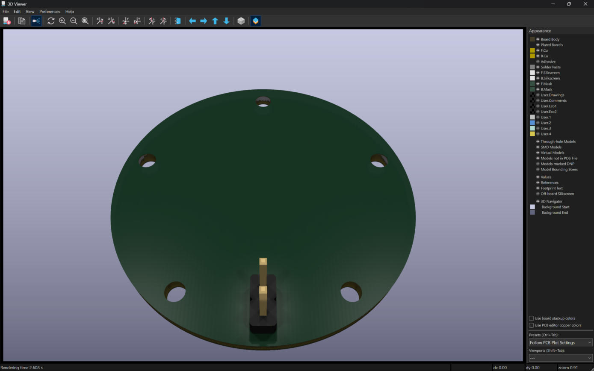
</p>

### Where KiCad still needed my hands

Some things had no Konnect tool, or KiCad's API refused them. Each time, Claude stopped and gave me the exact click to make:

- **Close or reopen KiCad** at the right moments. Rotations the API won't do can only be written to the file while KiCad is closed, and an open schematic editor locks its file.
- **Restart the Claude app** after a safety guard in Konnect refused to write to a board it had seen open in KiCad.
- In the PCB editor: delete two copper zones, hide the reference designators, drop the sun footprint in place, run *Update PCB from Schematic* (F8) and *Update Footprints from Library*, and press Escape when a leftover tool kept KiCad busy.

Claude also owned its mistakes. When one of its suggested fixes wiped the connector's 3D placement, it said so (*"My fault for not sequencing those"*), redid the placement with the sign corrected, and put that step last so nothing else could undo it.

At the end it even tried to publish the project. After I signed in to GitHub in the app's built-in browser, it created a repository by itself, but couldn't push to it. So I created this repo and pushed the KiCad files myself.

---

## Interlude: From PCB to idea

Two steps happened outside Claude:

1. **I imported the PCB into Fusion 360** by hand, and created an empty *Enclosure* component next to it.
2. **I asked ChatGPT for a picture** of what the lamp could look like. That single image ([`chat-gpt-design-inspiration.png`](assets/chat-gpt-design-inspiration.png)) was the whole design brief for the look.

---

## Chapter 2: The enclosure in Fusion 360

This was the prompt for the third chat, word for word:

> *"I want you to make an enclosure for a lamp in Fusion360 for the PCB we made earlier in KiCad with another chat. I've asked ChatGPT to render an image that I put in this folder. Use it as an inspiration. […] The features of the lamp are a rotative base, an inclinable head, and a place behind the PCB to put the batteries and the ON/OFF switch. Nothing cover the PCB, and the 5 mounting screws will use threaded brass inserts. The model has to be 3D printable in multiple parts that are easily assembled in the way you prefer. You need to create different component for the head, the body, and the base […]. All your sketches needs to be fully constrained and your design should be parametric, using references to previous dimensions when it's appropriate. **Before starting, ask me every questions you need to clear** and if at any point you doubt, feel free to stop and ask."*

### First, questions

Claude looked at the image and the Fusion design, then asked its questions as multiple-choice cards:

| Question | My answer |
|---|---|
| Power source? | 3 × AAA, in the base (the resistor values can change) |
| Battery holder? | An off-the-shelf 48 × 35 × 13 mm holder |
| ON/OFF switch? | A round 2-position switch, behind the head |
| How does the head hold its angle? | A 3D-printed screw |
| Overall size? | About 100 mm tall |
| Where does the cable go? | Hidden inside one arm |
| Battery access? | A snap-fit lid |
| Rotating base? | *"I don't want a rotative base anymore"* |

### First build, then one round of corrections

The first version took 118 tool calls: Head, Body, Base, a base lid and two tilt screws as separate components, every sketch fully constrained and driven by user parameters. My reply started *"That's a great design, but here's some fixes"* and listed what I wanted changed:

<details>
<summary><b>My correction prompt</b> (click to expand)</summary>

> The overall design should be softer, with more rounded or chamfered edges, less aggressive screw heads pattern...
>
> There should be a hole under the base lid to make it easier to remove because the little thing you made in the back won't be enough.
>
> It will be too hard to pass the electric wire in the arm with those 90 degrees angles.
>
> The joint is bad, its motion is set to rigid, and even when I changed it by hand the screw doesn't move with it as they should since they're screw down to the head.
>
> The threaded brass insert holes are not 3D printable since they are floating in the air, they should either have a start from below on the whole with a 45 degrees angle or go until the back of the head.
>
> I want you to add curved texts on the top of the base that goes around it. One in the front saying something like "Designed end to end by Claude with KiCad and Fusion360". One in the back saying "FLAVIEN BOULEAU 2026".
>
> I want you to add the mechanical parts: screws, batteries and battery holder, ON/OFF switch, inserts, and cable.
>
> I want you to add the appearance.

</details>

Claude worked through all of it in one go (80 tool calls). It gave the design rounder edges, put a finger hole in the lid, gave the arm channel smooth bends, made the tilt joint actually drive the head with the screws following it, and gave the brass insert bosses 45° bases so they print without supports. It also added the curved engraved texts, modelled every part from the hardware list and applied the appearances.

<table>
<tr>
<td width="50%">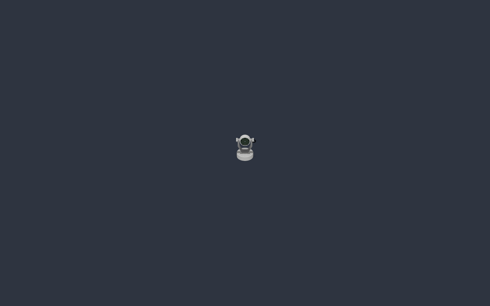</td>
<td width="50%">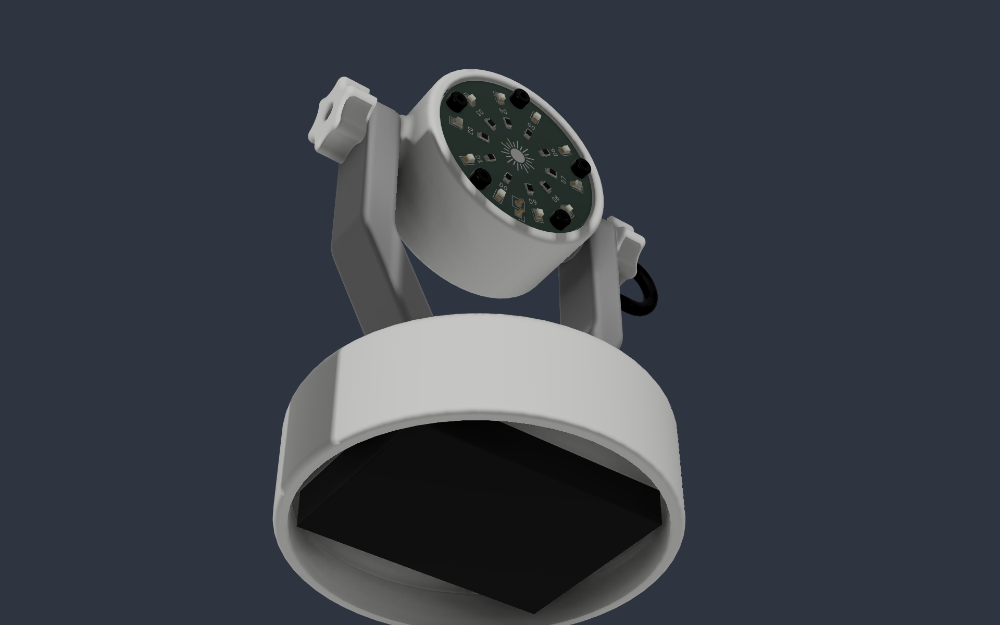</td>
</tr>
<tr>
<td align="center"><sub>Curved text engraved on the base</sub></td>
<td align="center"><sub>Lid removed: battery holder and cells</sub></td>
</tr>
</table>

### The cable problem: a real design conversation

The modelled cable didn't bend when the head tilted. I asked *"Is there a way to fix that ?"*. While Claude worked out the geometry of the loop, it found a real mechanical problem: a cable leaving the arm and entering the head at different points gets pulled or crushed as the head turns.

Its first explanation was too abstract (*"Sorry, that was too abstract. Here's what I mean"*), so it drew a diagram right in the chat. I still challenged it: *"Can't you just make the cable exit further down the arm?"*, then *"Why can't it enter the head at the same place?"*. That led to the best answer: **run the cable through the hollow tilt screw, along the pivot axis**, where turning the head doesn't stretch it at all.

<table>
<tr>
<td width="50%">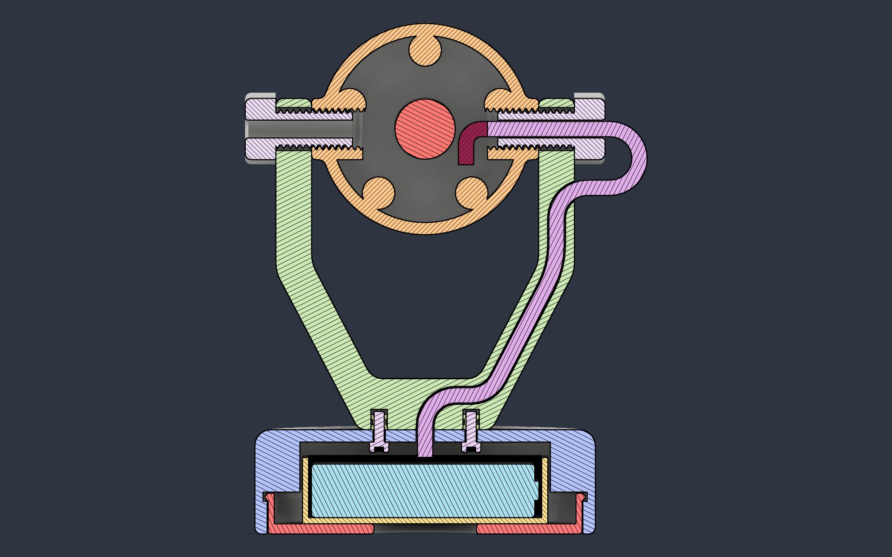</td>
<td width="50%">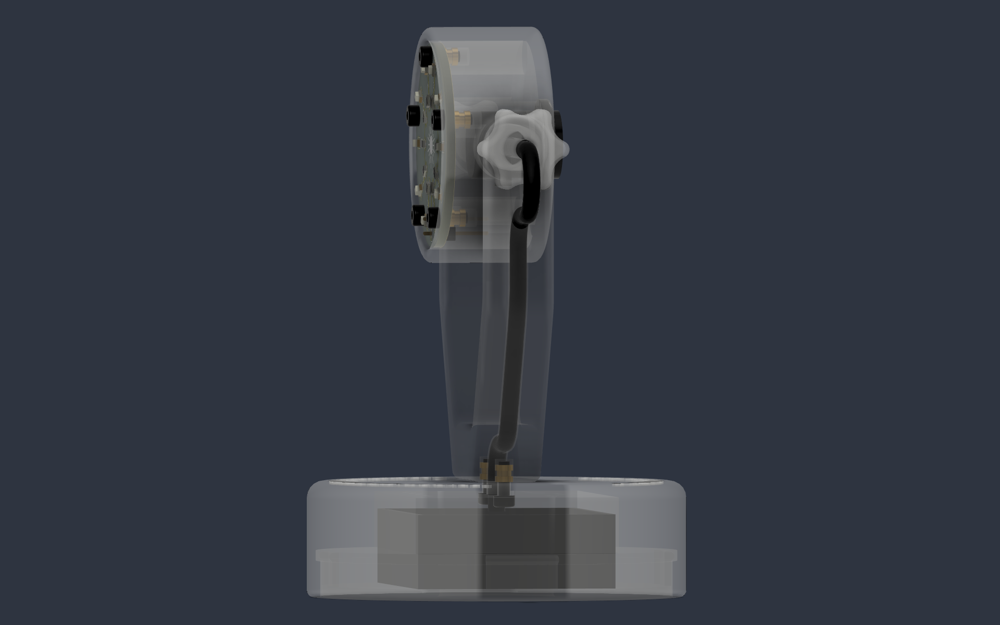</td>
</tr>
<tr>
<td align="center"><sub>Section through the tilt axis: the cable runs through the arm channel and the hollow screw</sub></td>
<td align="center"><sub>X-ray side view of the cable route</sub></td>
</tr>
</table>

### What's inside the model

- **Fully parametric:** user parameters drive the sizes, and changing `print_clear` (0.2 mm) re-fits every printed thread and gap.
- **Fully constrained sketches**, with a clean timeline you can replay (below).
- **Printable without supports:** each part has its own print orientation, and the inserts sit in 45° bosses.
- **Real hardware:** 7 brass inserts, M2 screws, the battery holder, the switch and a routed cable, all as components with joints. The PCB and screws follow the head through its full ±90° of tilt.

<p align="center">
  <br>
  <sub>The Fusion 360 timeline replayed: 149 steps, every feature placed by Claude</sub>
</p>

---

## Chapter 3: Documentation in a single prompt

> *"Now can you create a folder `assets` and put inside a lot of screenshots to document everything. I want screenshots of KiCad (schematics, pcb editor, pcb 3d viewer) and Fusion360 (a lot with different components visibility, light source, angle of the head, section analysis, components colors, video of history playing, ... every interesting combination). Then make a folder `export` and download there all the STL parts I need to print. […] You can also export from kicad everything needed for the PCB order and put it in `export`."*

From that one message, Claude produced:

- **52 Fusion viewport captures**: every angle, tilt steps from -90° to +90°, X-ray views, section analyses, colours per component and visual styles.
- **10 ray-traced renders** with different lighting environments.
- **3 videos**: a turntable, a tilt sweep and the timeline replay.
- **KiCad screenshots.** For these it used computer use, with my permission, to drive KiCad's windows and its 3D viewer.
- **5 STL files**, already in print orientation and checked to be watertight.
- **The PCB order package**: Gerbers, a ZIP ready for JLCPCB, the BOM, the pick-and-place file and the schematic as a PDF.

<table>
<tr>
<td width="50%">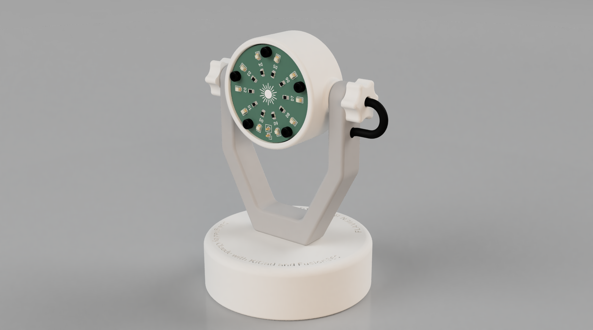</td>
<td width="50%">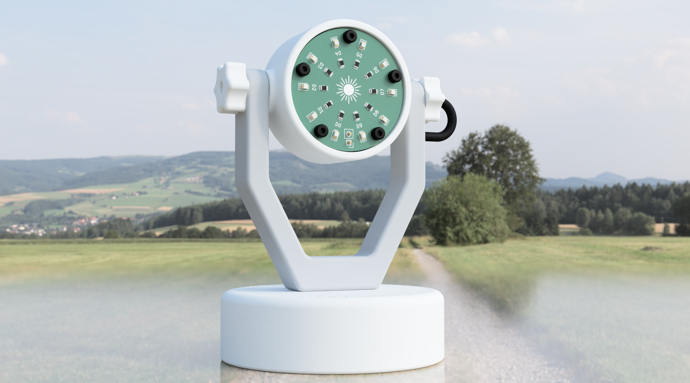</td>
</tr>
<tr>
<td width="50%">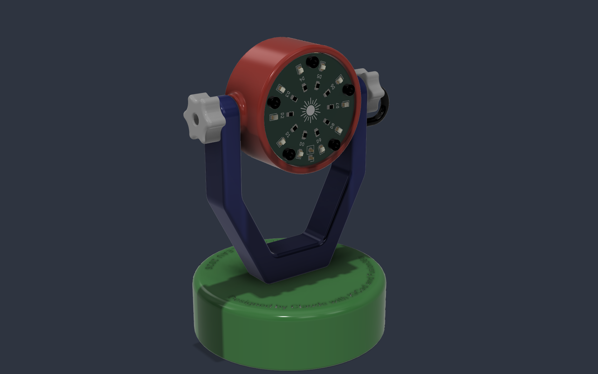</td>
<td width="50%">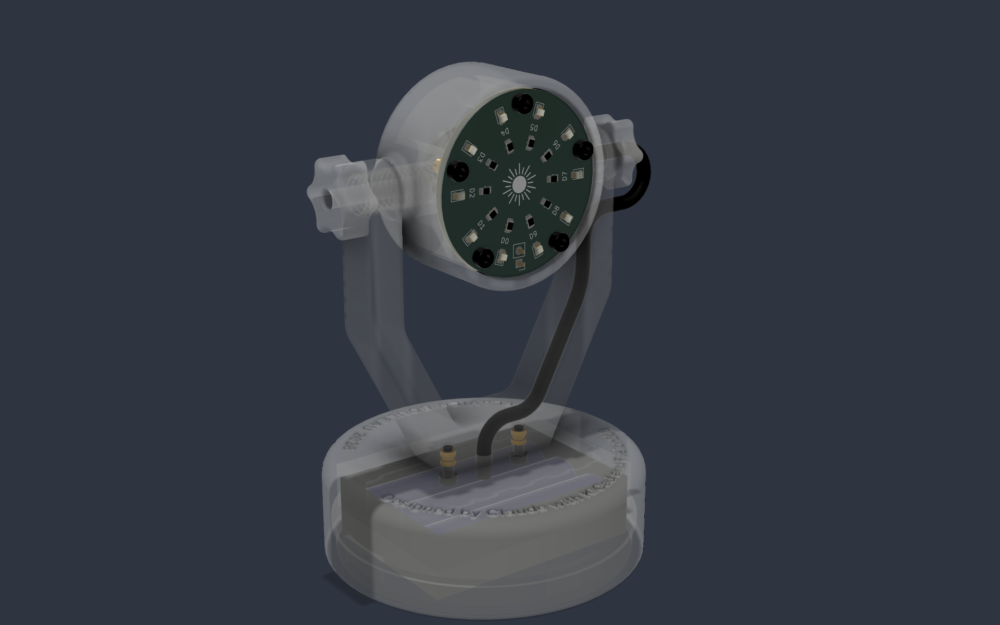</td>
</tr>
</table>

The full index is in [`assets/README.md`](assets/README.md).

---

## What I actually did

Here's the full list of what I did myself:

1. **Setup:** installed KiCad 10 and the Konnect plugin, edited two config files, and restarted the apps when asked. Fusion 360 was connected to Claude through its own MCP server.
2. **Prompting:** about 60 messages over three chats, counting short ones like *"go"*.
3. **Answering questions and pushing back**, which made a real difference twice: the single-layer board and the cable through the pivot.
4. **A dozen clicks in KiCad** that the tools couldn't do (listed in Chapter 1).
5. **Bridging the apps:** importing the PCB into Fusion 360 and asking ChatGPT for one image.
6. **Small touches:** a couple of appearance colours in Fusion, saving the design, and the git commits.
7. **For this README:** exporting my chat history so Claude could read the earlier chats.

## What the chats felt like

- **Claude asked before it built.** The enclosure chat opened with a set of multiple-choice questions, and the PCB chat paused whenever a choice was really mine to make (snapping parts to 90°, the board size, whether to rename the resistors too).
- **It checked its own work and showed the numbers:** ERC and DRC counts after every change, pad coordinates checked against its predictions, a collision check of the head at real tilt angles, and watertight checks on the STL files.
- **It said clearly when a tool couldn't do something,** explained why, and handed me the exact click. It didn't pretend.
- **Pushing back worked.** Both of my "are you sure?" moments made the result better.
- **These were long working sessions, not one-shot prompts.** The setup took an afternoon of trial and error. The PCB and enclosure chats each made hundreds of tool calls and ran for hours, mostly without me.

---

## Repository map

```
.
├── claude-x-kicad-x-fusion360.kicad_pro / .kicad_sch / .kicad_pcb   KiCad project
├── claude-x-kicad-x-fusion360.f3d                                   Fusion 360 design (enclosure + PCB)
├── sunlogo.pretty/                     The generated sun logo footprint
├── assets/                             Screenshots, renders, videos, inspiration image
│   ├── kicad/   fusion/   fusion/renders/   fusion/videos/   readme/
└── export/                             Everything needed to build it
    ├── stl/                            5 print-ready parts
    ├── pcb/                            Gerbers, JLCPCB ZIP, BOM, pick-and-place, schematic PDF
    └── pcb.step                        3D model of the assembled PCB
```

## Build one

Everything is in [`export/`](export/README.md): STL files with print settings, PCB order files, the hardware list (inserts, M2 screws, AAA holder, switch, cable) and the assembly steps.

## Project history

| Commit | Step |
|---|---|
| `db6db27` | PCB by Claude with KiCad |
| `cf27203` | Manual import of the PCB in Fusion 360 |
| `0bd1962` | Design inspiration by ChatGPT |
| `277b937` | 3D design after the first prompt, by Claude with Fusion 360 |
| `0096e14` | 3D design after two correction prompts |
| `870d102` | Renders, screenshots, videos and exports, all from a single prompt |

---

<div align="center">
<sub>Designed by Flavien Bouleau with Claude, 2026. This README was written by Claude as well, from exports of the three chats.</sub>
</div>
